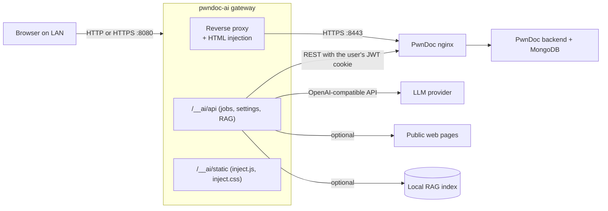

# Architecture

## Overview

PwnDoc is used as-is. A gateway process sits between the browser and PwnDoc's nginx front end,
forwards everything, and adds the AI controls.



```text
Browser -> gateway :8080 -> PwnDoc nginx :8443 -> PwnDoc backend
                |
                +-> /__ai/api/*  -> PwnDoc REST API (same cookie) and LLM provider
```

## Request flow

1. **Proxy.** Every path that does not start with `/__ai/` (including the `/socket.io` live-editing
   channel) is forwarded to `PWNDOC_URL`. Every `text/html` response gets
   `<link href="/__ai/static/inject.css">` and `<script src="/__ai/static/inject.js">` injected before
   `</body>`. `Domain` is always removed from `Set-Cookie`, and `Secure` only when the browser
   reaches the gateway over plain HTTP. `Location` headers pointing at `PWNDOC_URL` are rewritten to
   the gateway origin. When the browser is on plain HTTP, the CSP directives
   `upgrade-insecure-requests` and `block-all-mixed-content` are dropped from proxied responses,
   otherwise the browser would upgrade every sub-request to an HTTPS port the gateway does not serve.
   The pooled upstream HTTP client has an inert cookie jar: cookies are only ever forwarded from the
   requesting browser, never remembered between users.
2. **Injected script.** Watches PwnDoc's client-side routes. On `/audits/:id/...` it shows
   **✨ Update with AI**; for administrators it also offers **⚙ AI Settings**. It builds its UI with
   DOM APIs (no `innerHTML` with data) inside a Shadow DOM, so finding titles cannot inject markup and
   PwnDoc's CSS cannot clash.
3. **Authentication.** The script calls `/__ai/api/*` on the same origin. The gateway takes the
   browser's PwnDoc `token` JWT cookie and asks `GET /api/users/me` for the username and roles
   (current PwnDoc returns a `roles` list, older versions a single `role`; both are understood). A
   user is an administrator when `admin` is among the roles. The result is cached for 30 seconds per
   token (rejected tokens for 5 seconds), so a logout or role change can take that long to be seen by
   the AI endpoints. All PwnDoc reads and writes use the live cookie, so PwnDoc itself enforces
   permissions on every call, and no PwnDoc credentials are stored.
4. **Jobs, preview, apply, backup.**
   - A job is created for one audit with a chosen set of findings and fields. One worker thread runs
     each job; a user can have one active job, at most four run at once, and the last 50 are kept in
     memory, visible only to their owner.
   - For each finding the engine gathers optional context (web search, RAG), calls the LLM with a
     function schema (falling back to plain JSON), post-processes the result, and records a
     *proposal*; nothing is written to PwnDoc yet.
   - On **Apply**, the gateway re-reads each live finding from PwnDoc. The first apply of a job
     writes those live findings to `<data dir>/backups/<audit id>/<timestamp>_<job id>.json`. If a
     finding changed since the proposal it is reported as failed rather than overwritten; otherwise
     the change is sent with `PUT /api/audits/:id/findings/:findingId`, with custom fields merged onto
     the live list by label.
5. **Refinement post-processing.**
   - Custom fields whose labels are listed in `redact_field_labels` are left out of the prompt and are
     never changed. Redaction covers custom fields only; title, description, observation, PoC, scope,
     remediation and references are always sent.
   - Custom-field values are mapped back by label onto the original custom-field objects (ids are
     never model-made), and select/radio values must match one of the field's options.
   - Rich-text output passes the allow-list sanitiser. `` is limited to image ids already present
     in the finding; any evidence image the model dropped is re-appended from the original.
   - Title and single-line custom fields are reduced to plain text with no angle brackets.
   - References from the model are limited to http(s) URLs and CWE/CVE identifiers, merged after the
     originals, de-duplicated and capped.

## Components

| Module | Responsibility |
|---|---|
| `server.py`, `gateway.py` | FastAPI app: routes, identity and admin checks, job and settings API, static files |
| `limits.py` | Request-size limits for `/__ai/api` |
| `proxy.py` | HTTP and WebSocket reverse proxy with header, cookie and HTML rewriting |
| `jobs.py` | Background jobs, proposals, apply with live-state conflict check, backups |
| `refiner.py` | Builds the request, validates the model output, produces the update payload |
| `context.py`, `web_context.py`, `rag.py` | Research context: web search with SSRF guard, optional local-document index |
| `llm.py`, `prompts.py` | OpenAI-compatible calls, tool schema, JSON and no-tools fallbacks, token accounting |
| `sanitize.py` | HTML allow-list, image policy |
| `config.py` | Validated, immutable settings; `0600` persistence; env overlay; secret masking |
| `pwndoc_client.py` | PwnDoc REST client (cookie forwarding or username/password login) |
| `pipeline.py`, `jsonio.py`, `cli.py` | Resumable JSON refine/upload pipeline and the command line |
| `tls.py` | Self-signed certificate for `--https` (`<data dir>/tls/gateway.{crt,key}`) |
| `static/` | Injected front-end script and styles |

## Security model

| Control | Detail |
|---|---|
| Identity | PwnDoc's own JWT cookie, validated by PwnDoc (30 s cache); no stored credentials |
| Admin-only settings | Role from `/api/users/me` is checked server-side before reading or changing settings, RAG documents or models |
| Locked settings | `pwndoc_url` and `verify_tls` cannot be changed from the browser; changing `llm_base_url` clears the stored key |
| CSRF | Every non-GET `/__ai/api` call requires `X-Requested-With: pwndoc-ai`; there is no CORS, and PwnDoc cookies stay `SameSite=Strict` |
| Session isolation | The shared upstream client never stores or replays cookies, so one user's session cannot reach another caller |
| Request limits | `/__ai/api` bodies capped at 1 MiB (21 MiB for document upload), enforced before parsing |
| Cookie `Secure` flag | Removed only when the browser is on plain HTTP; kept over HTTPS |
| Plain HTTP | The gateway refuses a non-loopback bind without `--https` or an explicit `--insecure-http` |
| Output sanitising | Allow-list of formatting tags; `` limited to PwnDoc image ids already in the finding; `<a>` limited to http(s)/mailto |
| SSRF guard | Web fetch refuses non-http(s) schemes and non-public addresses, pins the connection to the validated IP, re-checks every redirect hop, and caps size and time |
| Secrets | API key masked in every response, settings file `0600`, env-provided values never written to disk |
| Files | JSON outputs, backups and exports are created `0600` and new directories `0700` |
| Redaction | Labelled custom fields are omitted from the prompt and never altered by the model |
| Preview and backup | Nothing is written to PwnDoc without apply (or explicit auto-apply); live state is backed up first and conflicting edits are not overwritten |

## Known limitations

- **Plain-HTTP LAN risk.** With `--insecure-http`, credentials and session cookies are visible to
  anyone on the network path. Prefer `--https` or a trusted segment. The generated certificate is
  self-signed and only names `localhost`, `127.0.0.1` and the host name, so browsers will warn.
- **Open PwnDoc port.** Upstream publishes its own port on all interfaces, so PwnDoc is reachable
  directly as well as through the gateway unless you restrict it.
- **Prompt-injection residual risk.** Web pages, RAG documents and findings are untrusted input to
  the model. The prompt marks research as data, output is sanitised, restricted and previewed, but a
  determined injection can still bias the text. Always review before applying.
- **Shared LLM budget.** Any signed-in PwnDoc user can start jobs on the configured key.
- **WebSocket origin.** The gateway does not validate the `Origin` of proxied WebSocket upgrades and
  rewrites `Origin` toward PwnDoc, so it inherits whatever cross-site protection PwnDoc applies.
- **In-memory jobs.** Job state and previews are lost when the gateway restarts; backups on disk are
  not.
- **Short PwnDoc sessions.** The gateway uses the user's own token, which PwnDoc expires quickly;
  long automatic runs may need the remaining proposals applied after signing in again.
- **Data leaves your network.** Finding content goes to the configured LLM provider, and finding
  titles go to DuckDuckGo if web search is enabled.
